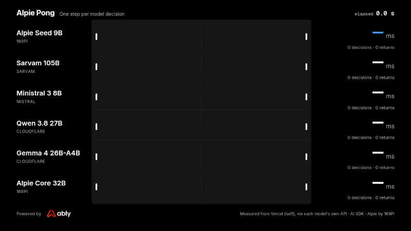
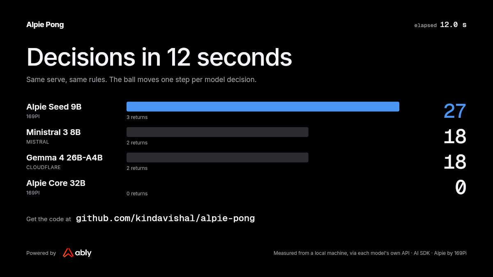

# Alpie Pong

Pong where the ball moves one step per model decision. Slow model, slow ball.



Alpie Pong races **Alpie Seed**, 169Pi's 9B model, against other models in a game that will not wait. Every lane plays the same game, asked the same question, and every ball moves only when its model answers. The time beside each court is the round trip of that one model call and nothing else.

**Play it: [alpie-pong.vercel.app](https://alpie-pong.vercel.app)**. Arrow keys or W/S, or drag on a phone.

Created by Vishal Das. Inspired by [Jev Pong](https://github.com/ably-labs/jev-pong) from Ably Labs.

## The race

| Lane | Model | Served by | Why it is here |
|---|---|---|---|
| **Alpie Seed 9B** | `alpie_9b`, thinking off | 169Pi | the model this site is about |
| Sarvam 105B | `sarvam-105b`, thinking off | Sarvam | the other Indian model family; about 10.3B parameters active per answer |
| Ministral 3 8B | `ministral-8b-2512` | Mistral | the Ministral 3 size closest to Seed's 9B; does not think |
| Qwen 3.8 27B | `@cf/qwen/qwen3.8-27b`, thinking off | Cloudflare Workers AI | three times Seed's size, a bigger rival |
| Gemini 3.5 Flash-Lite | `gemini-3.5-flash-lite`, reasoning effort minimal (its lowest) | Google, billed per call | Google's newest small Gemini; it cannot turn thinking off, and at "minimal" Google reported no thinking tokens |
| Nova 2 Lite | `us.amazon.nova-2-lite-v1:0`, reasoning off (its default) | Amazon Bedrock, billed per call | Amazon's small Nova; Amazon does not publish its size. It refuses Bedrock's JSON-schema output, so it answers through a tool call it is made to use |

Gemma 4 26B-A4B and Alpie Core 32B raced until 26 October 2026 and are now measured in the comparison only: Gemma because Gemini gave Google a lane on its own API, so Google had two, and it was the least steady lane; Alpie Core because it raced watch-only, about three decisions in 45 seconds, to show what thinking costs, which the comparison table shows with numbers.

The rivals are chosen to be fair to Alpie Seed: about its size or larger where the lab publishes a size (Google and Amazon do not, for Gemini 3.5 Flash-Lite and Nova 2 Lite), one per lab, and answering without thinking first, or at the lowest reasoning setting their API accepts. The first rivals are free to start on with no credit card, as Alpie is. The frontier labs' small models that follow are billed per call, and their lanes say so: Gemini 3.5 Flash-Lite, then Nova 2 Lite.

Ministral 3 8B is also served on Bedrock, but it races on Mistral's own API, as every rival races on its own lab's API. In the published comparison, measured from Vercel's iad1 beside Bedrock's us-east-1 on 27 October 2026, the same weights were slower on Bedrock (488 ms median against 389 ms) and got two fewer of 30 right, so moving it would also have handicapped a rival. Both rows are in the comparison.

Every lane that can think races with thinking off through the same switch, the chat template's `enable_thinking: false`, sent to Alpie Seed, Sarvam and Qwen alike. Gemini cannot turn thinking off at all, so it runs at its lowest setting, Nova 2 Lite reasons only when asked to, and Ministral 3 does not think at all, so neither is sent a switch. Sarvam's `reasoning_effort` does not turn thinking off: "low" is its lowest named level, and its docs say setting it to null disables reasoning, but on 26 October 2026 null, "low", "medium", "high" and leaving it out all thought for about 160 to 540 tokens per answer, so the race does not use it. The comparison on the how-it-works page shows it as Sarvam's thinking-on row, over the same 30 states as every other row. Alpie Core, in the comparison only since 26 October 2026, ignores the switch and thinks anyway, which is what its rows there are to show.

Alpie Seed and Alpie Core are called on 169Pi's test endpoint; the rivals are called on their providers' public APIs, free tiers for all but the billed lanes. The two are not necessarily provisioned the same way, and the numbers here do not separate the model from the service in front of it.

Recorded on 27 October 2026 from the deployed site, in a Vercel function in iad1 (Washington, D.C.), each model through its own API, 45 seconds per lane:

| Lane | Decisions | Per second | Average | p95 | Returns |
|---|---|---|---|---|---|
| **Alpie Seed 9B** | **173** | **3.82** | **261 ms** | 262 ms | 22 |
| Sarvam 105B | 104 | 2.29 | 410 ms | 582 ms | 10 |
| Ministral 3 8B | 96 | 2.11 | 471 ms | 823 ms | 11 |
| Qwen 3.8 27B | 72 | 1.58 | 624 ms | 891 ms | 9 |
| Gemini 3.5 Flash-Lite | 58 | 1.27 | 779 ms | 1,060 ms | 7 |
| Nova 2 Lite | 53 | 1.16 | 805 ms | 1,277 ms | 7 |

Alpie Seed made 173 decisions in this recording, as in the two before it from iad1 (25 and earlier on 27 October). Its calls are new each time, but it answers in about 258 ms nearly every time, so 45 seconds holds the same 173. Nothing is retried, so a slow call is the service as much as the model.

A lane plays on past five points in a recording, so every lane plays the whole 45 seconds. It still ends if its API refuses three calls in a row, and Sarvam's did: its API answered HTTP 429, a rate limit, after 104 calls, and its lane stopped at 42.3 s. Its decisions per second are still divided by the full 45 seconds, as every lane's are. The same happened after about 110 calls in a recording from a Mac in India, while the earlier recording from iad1 on 27 October made 107 calls without one. Sarvam sends no rate-limit headers, so its limit is not known.

The clip and the end card below are still from the 25 October recording, with Gemma 4 and Alpie Core in it and without Gemini 3.5 Flash-Lite or Nova 2 Lite, until they are rendered again from this one.



Each latency is the round trip from that server to the model's own API, so it includes the network distance to wherever the provider serves the model. Sarvam's API is in Mumbai (an Amazon address there) and Bedrock's us-east-1 is in Ashburn, Virginia. Alpie's endpoint, Mistral's API and Cloudflare's and Google's APIs are reached through anycast networks, so where their models run cannot be seen from outside; Alpie's endpoint answers a trivial request from India about a quarter of a second past Cloudflare's local edge, as a server in the United States would. From iad1, Mumbai is the far trip; from a machine in India, as the Indian models table below shows, Sarvam 105B is faster than Alpie Seed. Every number on the site is read from `public/replay-stats.json`; nothing is typed in by hand.

### Models we tried and left out

- **Gemini 3.5 Flash-Lite on Google's free tier**: it allows 15 requests a minute, and a lane makes about 60, so a free lane stops within seconds. With billing on, the limit lifts, and it now races as a billed lane.
- **Gemma 4 on Google AI Studio**: failed about one call in six. The same model raced on Cloudflare until 26 October 2026, and is in the comparison now.
- **gpt-oss-20b**: its API cannot switch reasoning off, which would make the lane a test of thinking rather than of the model.
- **Sarvam 105B** was left out at first for the same reason, wrongly: its documented `reasoning_effort` setting never goes below "low", but the API also accepts the chat template's `enable_thinking` switch, which turns thinking off. It now races.
- **Llama 3.1 8B, Qwen 3 30B-A3B and Granite 4.0 Micro** on Cloudflare: Llama cannot return a JSON schema and took 3.5 to 4.6 s, Qwen returned empty replies, and Granite got half its moves wrong. Qwen's replies were not empty: Cloudflare filed them under `reasoning` instead of `content`. Every lane now reads such a reply (`replyFromReasoning` in `lib/decide/endpoints.ts`), and Qwen 3 30B-A3B then answered all 30 states, 22 right, at a 435 ms median from a laptop on 26 October 2026, in a run that was not saved and is not in the published table. It is not in the race because Qwen 3.8 27B already gives Qwen its lane.
- **Grok 4.7 on Bedrock**: it cannot stop reasoning ("low" is its lowest effort) and refuses any temperature, so it is in the comparison, not the race.
- **Claude Haiku 5.5 and GPT-6 Luna on Bedrock**: AWS refused both calls on 27 October 2026 because the AWS account has no valid payment method for Marketplace models, so neither has been measured.

### Other Indian models

Alpie Seed's rivals were also searched for among Indian models (26 October 2026). Sarvam 105B is the only one served free on a provider's own API. What else exists:

- **Sarvam 30B and Sarvam-M** are retired from Sarvam's API, which answers both with "has been deprecated". Of Sarvam's own models it now serves only Sarvam 105B and a conversational variant of it.
- **Sarvam-M (24B, built on Mistral Small 3.1)** and **Fractal's Fathom-R1-14B (built on DeepSeek-R1-Distill-Qwen-14B)** are still served by Featherless through the Hugging Face router, which charges for every call (a free Hugging Face account gets no monthly credits). Both are in the comparison tool, not the race. Featherless rejects the `enable_thinking` switch, so Sarvam-M runs with no switch; it answered the schema in 5 or 6 tokens, so it did not think first. Fathom always thinks unless the schema stops it: with the schema it answered in 8 or 9 tokens, and allowed to think it ran to the 8,192-token limit with no answer after about 81 s, twice.
- **Krutrim-2 (12B)** is no longer served: Krutrim Cloud's catalogue now holds only other companies' models.
- **BharatGen Param2 17B-A2.4B** (under BharatGen's non-commercial licence) and **Sarvam 30B** are open weights with no hosted API that we could find. Hosting them ourselves would time our own hardware rather than a provider's service, so they are not in either table.
- **Zoho Zia LLM** was announced in July 2025 at 1.3B, 2.6B and 7B; we found no public API for it. **Soket, Tech Mahindra (Indus), Genloop, CoRover (BharatGPT) and Hanooman**: no public chat API or hosted model found. **Gnani**'s Inya VoiceOS is a 5B voice-to-voice research preview, and its other released models are for speech, not text chat.

The same 30 states went to Alpie Seed, Sarvam 105B and the two Featherless models in one run, one call at a time, recorded in `public/indian-comparison.json` and shown on the how-it-works page. This run was made from a Mac on home broadband in India through `pnpm dev`, so the latencies include that connection; it can be repeated from Vercel once the deployment has `HF_TOKEN`. The race table above and the wider comparison on the how-it-works page were measured from Vercel, so this table is not comparable with them; its rows are comparable with each other. From India, Sarvam's API in Mumbai is a far shorter trip than Alpie Seed's endpoint, which answers as a server in the United States would, and that is likely much of why Sarvam 105B is faster than Alpie Seed here and not from iad1.

| Model | Served by | Setting | Correct | Median | p95 |
|---|---|---|---|---|---|
| Alpie Seed 9B | 169Pi | thinking off | 30 / 30 | 401 ms | 403 ms |
| Sarvam 105B | Sarvam | thinking off | 21 / 30 | 226 ms | 317 ms |
| Fathom-R1-14B | Featherless | schema enforced, so no room to think | 7 / 30 | 1,605 ms | 3,649 ms |
| Sarvam-M 24B | Featherless | default, no thinking switch accepted | 24 / 30 | 1,624 ms | 3,240 ms |

Neither Featherless model is in the race: both are billed per call, and their medians are about four times Alpie Seed's. An earlier run the same day, with the free race lanes alongside, gave similar figures (Sarvam-M 24 right at 1,717 ms, Fathom 6 of 29 answered right at 1,682 ms, Sarvam 105B 20 right at 235 ms); its Qwen 3 30B-A3B result is the one quoted above. That run was not saved to a file.

## What counts as one decision

The state is a JSON object of numbers and nothing else, about 125 bytes:

```json
{"court":{"w":160,"h":100},"ball":{"x":80,"y":50,"vx":19,"vy":4.4},"paddle":{"y":50,"h":20},"interceptY":67.4,"dir":"toward"}
```

The question is `DECISION_INSTRUCTIONS` in `lib/decide/prompt.ts`: move the right paddle to cover `interceptY`, treating it as covered within five units. There are three answers, `up`, `down` and `stay`, described by `MOVE_CRITERIA` in the same file. Every lane reads those two constants, so nothing is worded twice.

Every lane is asked through its own provider's API with structured output, a JSON schema that allows only those three answers, at temperature 0 and the lowest reasoning setting that API accepts. Nobody gets a retry. Alpie Core's API ignores the schema and writes its reasoning out, so its move is read from its final answer (`moveFromText` in `lib/decide/llm.ts`). On Amazon Bedrock the schema is held by a tool call the model must make, since Nova 2 Lite refuses Bedrock's schema output, and Grok 4.7 (comparison only) refuses any temperature, so it is sent none.

One decision moves the ball one segment, and eight segments cross the court. Nothing is skipped or sped up, so a lane's speed is its model's decision latency. When you play, a step never completes faster than 260 ms, so a fast model is a game rather than a reflex test; the published latency is still the real one.

## How a game runs

Every participant in a game is a member of one [Ably](https://ably.com) channel, `pong:game:{id}`, including the model.

- The browser gets a short-lived token from `/api/ably-token`, enters presence as a player, subscribes to `state` and publishes `input`. An input is a level, not an event: `up`, `down` or `stay`, repeated while held, and forgotten after 400 ms, so a closed laptop can never pin a paddle against the wall.
- The model's side is a worker started by `POST /api/game` and kept alive inside the same function invocation with `after()`. It joins the channel, enters presence as `agent`, runs the physics, asks the model for a move once per ball step, and publishes a `state` snapshot after every decision.
- Spectators attach to the same channel with `rewind`, so a late joiner sees the current state at once. The viewer count is presence.
- A referee ends the game when a score reaches five (a recording for the home page plays on past five instead, so every lane plays the whole window and its decisions per second are counted over time it actually played), when a player has been gone for 15 seconds, when nobody joined within a minute, when a demo has been unwatched for two minutes, or shortly before the platform deadline.

The browser predicts the player's own paddle and reconciles it against the wire only after a frame acknowledges the player's latest input, so the paddle never jumps backwards. The ball's step is timed by the worker's clock, not by when its frames arrived. `lib/ui/paddle.ts` and `lib/render/live.ts` are both pure and tested.

## Read the code in this order

1. `lib/game/types.ts`: the contract. The court, the mechanic, the lanes and the hero.
2. `lib/game/engine.ts`: the whole game as pure functions.
3. `lib/decide/prompt.ts`: the one question every model is asked, and its three answers.
4. `lib/decide/endpoints.ts`: how each lane reaches its model's own API, with no key in the code.
5. `lib/decide/llm.ts`: the one timed call, structured output or a move read from a prose answer.
6. `lib/worker/game-worker.ts`: the model as a member of the channel.
7. `lib/worker/referee.ts`: when a game stops, as a pure state machine.
8. `app/api/game/route.ts`: one HTTP request, one function, one game.
9. `lib/ably/hooks.ts`: everything a browser does.

## Run it

```bash
pnpm install
cp .env.example .env.local   # then fill in the keys
pnpm dev
```

Every model in the race but the billed lanes starts free, with no credit card:

| Variable | What it is for |
|---|---|
| `ABLY_API_KEY` | Realtime transport. Ably's free plan is enough; the key needs **publish**, **subscribe** and **presence**. |
| `ALPIE_SEED_BASE_URL`, `ALPIE_CORE_BASE_URL`, `ALPIE_API_KEY` | Alpie Seed and Alpie Core on 169Pi's API (OpenAI-compatible, ending in `/v1`). |
| `GEMINI_API_KEY` | Gemini 3.5 Flash-Lite on Google's Gemini API, a billed lane: a key from Google AI Studio, with billing on for its project. |
| `BEDROCK_API_KEY`, `BEDROCK_REGION` | Nova 2 Lite in the race, and the Bedrock rows in the comparison, billed per call to the AWS account: a long-term Amazon Bedrock API key (it starts `ABSK`). The region defaults to `us-east-1`, beside Vercel's iad1. |
| `SARVAM_API_KEY` | Sarvam 105B, on Sarvam's free sign-up credits. |
| `MISTRAL_API_KEY` | Ministral 3 8B, on Mistral's free Experiment plan. |
| `CLOUDFLARE_ACCOUNT_ID`, `CLOUDFLARE_API_TOKEN` | Qwen 3.8 in the race, and Gemma 4 in the comparison, on Cloudflare Workers AI's free plan (a token from the "Workers AI" template). |
| `ADMIN_TOKEN` | Guards anything that spends model credit with nobody playing: `/arena`, demo games, `/api/record`, `/api/compare`. |
| `AI_GATEWAY_API_KEY` | Optional, for the original Vercel AI Gateway lanes in the comparison tool. |
| `HF_TOKEN`, `HF_BILL_TO` | Optional, for the Sarvam-M and Fathom-R1-14B comparison lanes on the Hugging Face router, which charges for every call. A fine-grained token with "Make calls to Inference Providers"; `HF_BILL_TO` names an organisation to bill instead of the token's owner. |

`.env.example` lists them all. No key reaches a browser.

It deploys to Vercel's free Hobby plan. Functions there run for at most 300 seconds, so a live game lasts up to 4 minutes 45 seconds (a game to five points usually takes one to two), and `/api/record` records at most 240 seconds.

```bash
pnpm test
pnpm typecheck
pnpm lint
```

## Re-recording

`POST /api/record` records the race and returns the replay and its stats; drop them into `public/`. `scripts/compare-models.ts` puts the question to more models, one call at a time, and writes `public/model-comparison.json`, which the how-it-works page renders. Run both from a deployment, so the latencies are measured from a server rather than from somebody's broadband. `pnpm render:clip` renders the recording as a video clip (it needs `ffmpeg`); the GIF and end card at the top of this file come from the same frame renderer.

## Credits

Alpie Pong is created by Vishal Das, inspired by [Jev Pong](https://github.com/ably-labs/jev-pong), an open-source demo by Ably Labs, and builds on its code under the Apache License 2.0. See `LICENSE` and `NOTICE`. Alpie Seed and Alpie Core are made by [169Pi](https://169pi.ai). Realtime transport by [Ably](https://ably.com). Next.js on Vercel, the AI SDK, Tailwind, and canvas courts with no game engine.
